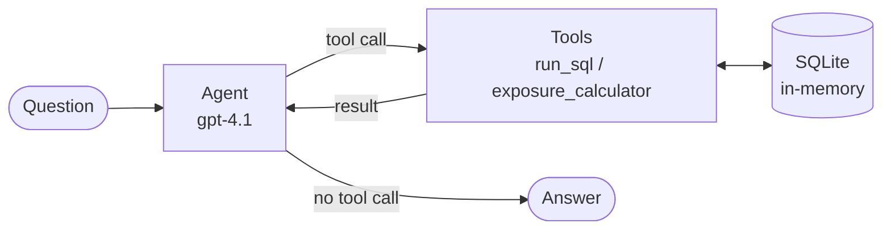

# Portfolio Analytics Agent

A command-line agent that answers natural-language questions about portfolio data.
It is built with **LangGraph** and **OpenAI** and uses two tools:

- **`run_sql`** turns a question into a SQL query against the portfolio database.
- **`exposure_calculator`** computes a portfolio's sector exposure (equities only).


---

## Quick start

Requires Python 3.10+.

```bash
python -m venv .venv
source .venv/bin/activate
pip install -r requirements.txt

cp .env.example .env        # then add your OPENAI_API_KEY
```

```bash
python cli.py "How many portfolios do we have?"     # one question
python cli.py                                       # interactive mode
python cli.py -v "Top 5 holdings in Growth Equity Fund by cost basis"   # show tool calls / SQL

python evaluate.py                                  # run the ground-truth evaluation
python -m pytest -q                                 # unit tests (no API calls)
```

In interactive mode, follow-up questions keep context. Type `/new` to start a new
conversation and `exit` to quit.

---

## How it works



1. On startup, the CSV files are loaded into an in-memory SQLite database using
   `database_schema.sql`.
2. The LLM receives the question and a system prompt containing the schema,
   including the actual values of key columns (e.g. `target_risk_level: 'High', 'Low', 'Medium'`).
   This helps it write filters that match the data exactly.
3. The LLM picks a tool. LangGraph runs it and passes the result back.
4. The loop repeats until the LLM replies without a tool call. That reply is the answer.

If a SQL query fails, the error message is returned to the LLM so it can fix
the query and try again. The loop is capped at 12 steps.

### Tools

**`run_sql`**: executes one read-only query and returns columns and rows (max 200 rows).
SQL safety is handled in three layers:

| Layer | Prevents |
|---|---|
| Query must start with `SELECT` / `WITH` | Writes and DDL statements |
| sqlite3 runs a single statement per call | `SELECT 1; DROP TABLE ...` |
| `PRAGMA query_only = ON` on the connection | Any write that slips through |

**`exposure_calculator`**: given a portfolio name, groups the portfolio's **stock**
holdings by sector and sums their weights. Bonds are excluded.

- Exposures are shown as a percentage of the equity holdings, so they add up to 100%.
- The equity share of the whole portfolio is reported alongside.
- Portfolio names are matched loosely ("international equity" → *International Equity Fund*).
  An ambiguous name returns an error listing the candidates.

---

## Project structure

```
cli.py                      Command-line interface
evaluate.py                 Evaluation runner
portfolio_agent/
  config.py                 Paths, model name, limits
  db.py                     Loads CSVs into SQLite, describes the schema for the prompt
  prompts.py                System prompt
  graph.py                  LangGraph graph and tool wrappers
  agent.py                  PortfolioAgent: the main entry point
  evaluation.py             Scoring logic
  tools/
    sql_tool.py             Query validation and execution
    exposure_tool.py        Sector exposure calculation
tests/                      Unit tests (offline, use a fake LLM)
```

The tools are plain Python functions with no LangChain dependency. `graph.py` is the
only place they are wrapped for the LLM, so each tool can be tested on its own.

---

## Evaluation

`python evaluate.py` runs every question in `ground_truth_dataset.json` through the
agent and scores it.

**SQL questions**: generated SQL is not compared as text, because two different queries
can be equally correct. Instead, both the expected and the generated query are
executed and their **results** are compared. Row order, column order, extra columns
and small rounding differences are ignored.

| Verdict | Meaning |
|---|---|
| PASS | Same rows as the expected result |
| PARTIAL | All expected rows are present, plus some extra rows |
| FAIL | Expected rows are missing or different |

**Exposure questions**: the agent must call `exposure_calculator`, the tool must
resolve the expected portfolio, and the final answer must mention every sector.

A full report (generated SQL, answers, timings) is written to `eval_report.json`.

### Results (gpt-4.1)

| ID | Difficulty | Verdict | Notes |
|---|---|---|---|
| 1–6 | easy / medium | PASS | |
| 7 | hard | PARTIAL | Also lists portfolios with 0% technology. The expected query leaves them out. |
| 8 | hard | FAIL | Finds the right portfolio, but reads "diversification metrics" as the risk-metrics table. The expected answer is a sector-count / holding-count ratio. |
| 9–10 | medium | PASS | |

**8/10 strict, 9/10 including partial.** Average response time is about 3 seconds.

---

## Design decisions

- **Custom LangGraph graph instead of `create_react_agent`.** The graph is small and
  explicit, and it is easy to add steps later (e.g. SQL validation before execution).
- **Schema with sample values in the prompt.** A common text-to-SQL mistake is a filter
  value that doesn't match the data (`'high'` vs `'High'`). Listing the real values
  prevents this. The schema is small, so retrieval (RAG) is not needed.
- **Errors are returned to the LLM, not raised.** This lets the agent recover from a
  bad query without failing the whole request.
- **In-memory database.** Fast to rebuild from CSVs and can never be modified.
- **Temperature 0.** Makes answers as repeatable as possible, which matters for evaluation.

## Limitations and next steps

- Ambiguous questions (like Q8) are answered with one interpretation. A clarifying
  question would be better.
- Answers are only checked for tool usage and data, not for wording quality.
  An LLM-as-judge step could cover that.
- Possible extensions: questions that need both tools, a Streamlit UI or REST API,
  and caching for repeated questions.

## Configuration

| Variable | Default | Description |
|---|---|---|
| `OPENAI_API_KEY` | — | Required |
| `OPENAI_MODEL` | `gpt-4.1` | Any OpenAI chat model that supports tool calling |
